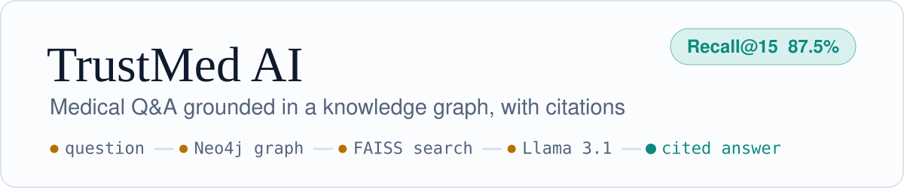
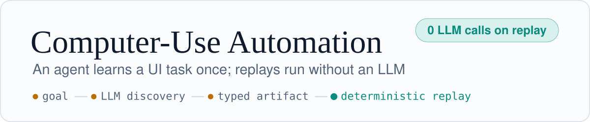
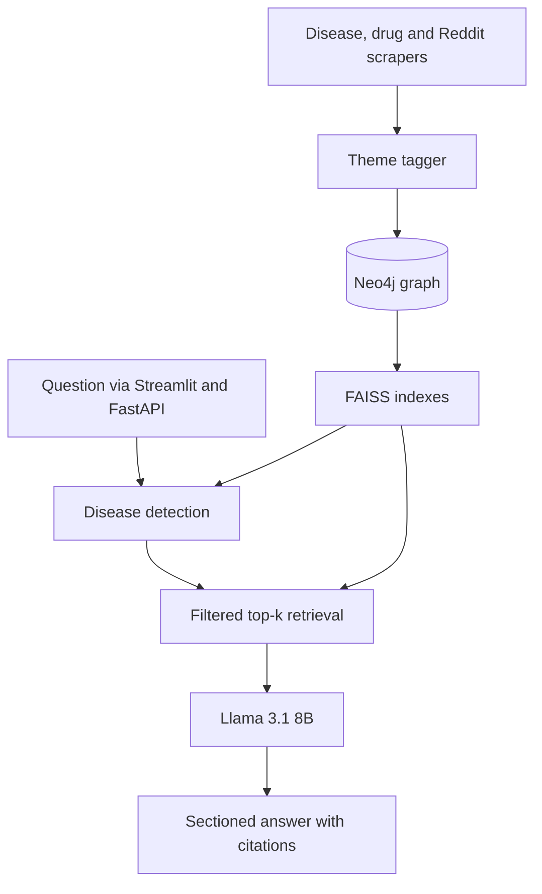
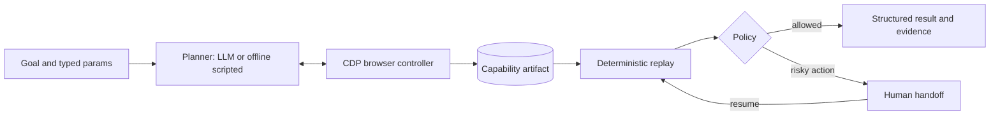

<picture>
  <source media="(prefers-color-scheme: dark)" srcset="assets/hero-dark.svg">
  
</picture>


<br>

<p align="center">
  Full-time <b>Software Development Intern</b> at <a href="https://github.com/Next-Play-Games"><b>Next Play Games</b></a>, shipping payments, team management, coach messaging and an AI personal trainer for the <b>SportX1</b> platform. On my own projects, I build AI systems whose output can be checked.
</p>

<p align="center">
  <a href="https://www.linkedin.com/in/dhyan-patel-94101b22a/"></a>
  <!-- TODO: add email / portfolio badges in the same style -->
</p>

<p align="center">
  <a href="#user-content-about-me">01&ensp;About me</a>&emsp;&emsp;<a href="#user-content-page-2">02&ensp;Next Play Games</a>&emsp;&emsp;<a href="#user-content-page-3">03&ensp;Featured projects</a>
</p>

<table>
<tr>
<td valign="top">
<p align="right"><sub>&nbsp;&nbsp;&nbsp;&nbsp;&nbsp;&nbsp;&nbsp;&nbsp;&nbsp;&nbsp;&nbsp;&nbsp;&nbsp;&nbsp;&nbsp;&nbsp;&nbsp;&nbsp;&nbsp;&nbsp;&nbsp;&nbsp;&nbsp;&nbsp;&nbsp;&nbsp;&nbsp;&nbsp;&nbsp;&nbsp;&nbsp;&nbsp;&nbsp;&nbsp;&nbsp;&nbsp;&nbsp;&nbsp;&nbsp;&nbsp;&nbsp;&nbsp;&nbsp;&nbsp;&nbsp;&nbsp;&nbsp;&nbsp;&nbsp;&nbsp;&nbsp;&nbsp;&nbsp;&nbsp;&nbsp;&nbsp;&nbsp;&nbsp;&nbsp;&nbsp;&nbsp;&nbsp;&nbsp;&nbsp;&nbsp;&nbsp;&nbsp;&nbsp;&nbsp;&nbsp;&nbsp;&nbsp;&nbsp;&nbsp;&nbsp;&nbsp;&nbsp;&nbsp;&nbsp;&nbsp;&nbsp;&nbsp;&nbsp;&nbsp;&nbsp;&nbsp;&nbsp;&nbsp;&nbsp;&nbsp;&nbsp;&nbsp;&nbsp;&nbsp;&nbsp;&nbsp;&nbsp;&nbsp;&nbsp;&nbsp;&nbsp;&nbsp;&nbsp;&nbsp;&nbsp;&nbsp;&nbsp;&nbsp;&nbsp;&nbsp;&nbsp;&nbsp;&nbsp;&nbsp;&nbsp;&nbsp;&nbsp;&nbsp;&nbsp;&nbsp;&nbsp;&nbsp;&nbsp;&nbsp;&nbsp;&nbsp;&nbsp;&nbsp;&nbsp;&nbsp;&nbsp;&nbsp;&nbsp;&nbsp;&nbsp;&nbsp;&nbsp;&nbsp;&nbsp;&nbsp;&nbsp;&nbsp;&nbsp;&nbsp;&nbsp;&nbsp;&nbsp;&nbsp;&nbsp;&nbsp;&nbsp;&nbsp;&nbsp;&nbsp;&nbsp;&nbsp;&nbsp;&nbsp;&nbsp;&nbsp;&nbsp;&nbsp;&nbsp;&nbsp;&nbsp;&nbsp;&nbsp;&nbsp;&nbsp;&nbsp;&nbsp;&nbsp;&nbsp;&nbsp;&nbsp;&nbsp;&nbsp;&nbsp;&nbsp;&nbsp;&nbsp;&nbsp;&nbsp;&nbsp;&nbsp;&nbsp;&nbsp;&nbsp;&nbsp;&nbsp;&nbsp;&nbsp;&nbsp;&nbsp;&nbsp;&nbsp;&nbsp;&nbsp;&nbsp;&nbsp;&nbsp;&nbsp;&nbsp;&nbsp;&nbsp;&nbsp;&nbsp;&nbsp;&nbsp;&nbsp;&nbsp;&nbsp;&nbsp;&nbsp;&nbsp;&nbsp;&nbsp;&nbsp;&nbsp;&nbsp;&nbsp;&nbsp;&nbsp;&nbsp;&nbsp;&nbsp;&nbsp;&nbsp;&nbsp;&nbsp;&nbsp;&nbsp;&nbsp;&nbsp;&nbsp;&nbsp;&nbsp;&nbsp;&nbsp;&nbsp;&nbsp;&nbsp;&nbsp;&nbsp;&nbsp;&nbsp;&nbsp;&nbsp;&nbsp;&nbsp;&nbsp;&nbsp;&nbsp;&nbsp;&nbsp;&nbsp;&nbsp;&nbsp;&nbsp;&nbsp;&nbsp;&nbsp;&nbsp;&nbsp;&nbsp;&nbsp;&nbsp;&nbsp;&nbsp;&nbsp;01&nbsp;/&nbsp;03</sub><a name="page-1"></a></p>

### About me

```console
$ whoami
Dhyan Patel
applied AI and full-stack engineer

$ now
SWE intern @ Next Play Games
shipping SportX1: payments, teams,
messaging, AI personal trainer

$ stack --strongest
TypeScript, React, React Native,
Supabase, PostgreSQL, Python

$ open-to
software, full-stack and
applied AI engineering roles
```

**How I work**

- **I measure.** Retrieval metrics, targeted test suites and evidence logs, not adjectives.
- **I design for failure.** Allowlists, human handoffs and rules enforced on the server.
- **I ship end to end.** Schema, API and mobile UI, then the deployment workflow.

<p align="right"><a href="#user-content-page-2">Next: Next Play Games →</a></p>

</td>
<td valign="top">
<p align="right"><sub>&nbsp;&nbsp;&nbsp;&nbsp;&nbsp;&nbsp;&nbsp;&nbsp;&nbsp;&nbsp;&nbsp;&nbsp;&nbsp;&nbsp;&nbsp;&nbsp;&nbsp;&nbsp;&nbsp;&nbsp;&nbsp;&nbsp;&nbsp;&nbsp;&nbsp;&nbsp;&nbsp;&nbsp;&nbsp;&nbsp;&nbsp;&nbsp;&nbsp;&nbsp;&nbsp;&nbsp;&nbsp;&nbsp;&nbsp;&nbsp;&nbsp;&nbsp;&nbsp;&nbsp;&nbsp;&nbsp;&nbsp;&nbsp;&nbsp;&nbsp;&nbsp;&nbsp;&nbsp;&nbsp;&nbsp;&nbsp;&nbsp;&nbsp;&nbsp;&nbsp;&nbsp;&nbsp;&nbsp;&nbsp;&nbsp;&nbsp;&nbsp;&nbsp;&nbsp;&nbsp;&nbsp;&nbsp;&nbsp;&nbsp;&nbsp;&nbsp;&nbsp;&nbsp;&nbsp;&nbsp;&nbsp;&nbsp;&nbsp;&nbsp;&nbsp;&nbsp;&nbsp;&nbsp;&nbsp;&nbsp;&nbsp;&nbsp;&nbsp;&nbsp;&nbsp;&nbsp;&nbsp;&nbsp;&nbsp;&nbsp;&nbsp;&nbsp;&nbsp;&nbsp;&nbsp;&nbsp;&nbsp;&nbsp;&nbsp;&nbsp;&nbsp;&nbsp;&nbsp;&nbsp;&nbsp;&nbsp;&nbsp;&nbsp;&nbsp;&nbsp;&nbsp;&nbsp;&nbsp;&nbsp;&nbsp;&nbsp;&nbsp;&nbsp;&nbsp;&nbsp;&nbsp;&nbsp;&nbsp;&nbsp;&nbsp;&nbsp;&nbsp;&nbsp;&nbsp;&nbsp;&nbsp;&nbsp;&nbsp;&nbsp;&nbsp;&nbsp;&nbsp;&nbsp;&nbsp;&nbsp;&nbsp;&nbsp;&nbsp;&nbsp;&nbsp;&nbsp;&nbsp;&nbsp;&nbsp;&nbsp;&nbsp;&nbsp;&nbsp;&nbsp;&nbsp;&nbsp;&nbsp;&nbsp;&nbsp;&nbsp;&nbsp;&nbsp;&nbsp;&nbsp;&nbsp;&nbsp;&nbsp;&nbsp;&nbsp;&nbsp;&nbsp;&nbsp;&nbsp;&nbsp;&nbsp;&nbsp;&nbsp;&nbsp;&nbsp;&nbsp;&nbsp;&nbsp;&nbsp;&nbsp;&nbsp;&nbsp;&nbsp;&nbsp;&nbsp;&nbsp;&nbsp;&nbsp;&nbsp;&nbsp;&nbsp;&nbsp;&nbsp;&nbsp;&nbsp;&nbsp;&nbsp;&nbsp;&nbsp;&nbsp;&nbsp;&nbsp;&nbsp;&nbsp;&nbsp;&nbsp;&nbsp;&nbsp;&nbsp;&nbsp;&nbsp;&nbsp;&nbsp;&nbsp;&nbsp;&nbsp;&nbsp;&nbsp;&nbsp;&nbsp;&nbsp;&nbsp;&nbsp;&nbsp;&nbsp;&nbsp;&nbsp;&nbsp;&nbsp;&nbsp;&nbsp;&nbsp;&nbsp;&nbsp;&nbsp;&nbsp;&nbsp;&nbsp;&nbsp;&nbsp;&nbsp;&nbsp;&nbsp;&nbsp;&nbsp;&nbsp;&nbsp;&nbsp;&nbsp;&nbsp;&nbsp;&nbsp;&nbsp;&nbsp;&nbsp;&nbsp;02&nbsp;/&nbsp;03</sub><a name="page-2"></a></p>

### Next Play Games

<a href="https://github.com/Next-Play-Games">
<picture>
  <source media="(prefers-color-scheme: dark)" srcset="assets/plate-nextplay-dark.svg">
  
</picture>
</a>

**Software Development Intern**, full-time, June 2026 – present

SportX1 is a sports coaching and team-management platform. I work across its React Native app, React dashboard and Supabase/PostgreSQL backend, with **88 merged pull requests across five repositories** as of October 2026.

- **Registration and payments.** Square payments, installment plans, recurring invoices, coupons and audited cash and check payments. 142 targeted tests.
- **Organizations and teams.** Organization, group and team hierarchy with reassignment, multi-team membership, parent notifications and admin permissions.
- **AI personal trainer.** Training plans, habit tracking, progress, privacy-conscious sharing and server-validated XP. 74 focused tests.
- **Coach communication.** AI-assisted messaging, scheduled and recurring announcements, reply threads and reliable email delivery. 161 tests.
- **Reliability.** Database permissions, concurrency, migration ordering, and deploys that retry only on confirmed HTTP 409 conflicts.

**Stack.** TypeScript, React, React Native and Expo, Supabase, PostgreSQL, Square, GitHub Actions

<p align="right"><a href="#user-content-page-3">Next: Featured projects →</a></p>

</td>
<td valign="top">
<p align="right"><sub>&nbsp;&nbsp;&nbsp;&nbsp;&nbsp;&nbsp;&nbsp;&nbsp;&nbsp;&nbsp;&nbsp;&nbsp;&nbsp;&nbsp;&nbsp;&nbsp;&nbsp;&nbsp;&nbsp;&nbsp;&nbsp;&nbsp;&nbsp;&nbsp;&nbsp;&nbsp;&nbsp;&nbsp;&nbsp;&nbsp;&nbsp;&nbsp;&nbsp;&nbsp;&nbsp;&nbsp;&nbsp;&nbsp;&nbsp;&nbsp;&nbsp;&nbsp;&nbsp;&nbsp;&nbsp;&nbsp;&nbsp;&nbsp;&nbsp;&nbsp;&nbsp;&nbsp;&nbsp;&nbsp;&nbsp;&nbsp;&nbsp;&nbsp;&nbsp;&nbsp;&nbsp;&nbsp;&nbsp;&nbsp;&nbsp;&nbsp;&nbsp;&nbsp;&nbsp;&nbsp;&nbsp;&nbsp;&nbsp;&nbsp;&nbsp;&nbsp;&nbsp;&nbsp;&nbsp;&nbsp;&nbsp;&nbsp;&nbsp;&nbsp;&nbsp;&nbsp;&nbsp;&nbsp;&nbsp;&nbsp;&nbsp;&nbsp;&nbsp;&nbsp;&nbsp;&nbsp;&nbsp;&nbsp;&nbsp;&nbsp;&nbsp;&nbsp;&nbsp;&nbsp;&nbsp;&nbsp;&nbsp;&nbsp;&nbsp;&nbsp;&nbsp;&nbsp;&nbsp;&nbsp;&nbsp;&nbsp;&nbsp;&nbsp;&nbsp;&nbsp;&nbsp;&nbsp;&nbsp;&nbsp;&nbsp;&nbsp;&nbsp;&nbsp;&nbsp;&nbsp;&nbsp;&nbsp;&nbsp;&nbsp;&nbsp;&nbsp;&nbsp;&nbsp;&nbsp;&nbsp;&nbsp;&nbsp;&nbsp;&nbsp;&nbsp;&nbsp;&nbsp;&nbsp;&nbsp;&nbsp;&nbsp;&nbsp;&nbsp;&nbsp;&nbsp;&nbsp;&nbsp;&nbsp;&nbsp;&nbsp;&nbsp;&nbsp;&nbsp;&nbsp;&nbsp;&nbsp;&nbsp;&nbsp;&nbsp;&nbsp;&nbsp;&nbsp;&nbsp;&nbsp;&nbsp;&nbsp;&nbsp;&nbsp;&nbsp;&nbsp;&nbsp;&nbsp;&nbsp;&nbsp;&nbsp;&nbsp;&nbsp;&nbsp;&nbsp;&nbsp;&nbsp;&nbsp;&nbsp;&nbsp;&nbsp;&nbsp;&nbsp;&nbsp;&nbsp;&nbsp;&nbsp;&nbsp;&nbsp;&nbsp;&nbsp;&nbsp;&nbsp;&nbsp;&nbsp;&nbsp;&nbsp;&nbsp;&nbsp;&nbsp;&nbsp;&nbsp;&nbsp;&nbsp;&nbsp;&nbsp;&nbsp;&nbsp;&nbsp;&nbsp;&nbsp;&nbsp;&nbsp;&nbsp;&nbsp;&nbsp;&nbsp;&nbsp;&nbsp;&nbsp;&nbsp;&nbsp;&nbsp;&nbsp;&nbsp;&nbsp;&nbsp;&nbsp;&nbsp;&nbsp;&nbsp;&nbsp;&nbsp;&nbsp;&nbsp;&nbsp;&nbsp;&nbsp;&nbsp;&nbsp;&nbsp;&nbsp;&nbsp;&nbsp;&nbsp;&nbsp;&nbsp;&nbsp;&nbsp;&nbsp;&nbsp;&nbsp;&nbsp;&nbsp;&nbsp;&nbsp;03&nbsp;/&nbsp;03</sub><a name="page-3"></a></p>

### Featured projects

<a href="https://github.com/DhyanICT/Trusted_Medical_AI">
<picture>
  <source media="(prefers-color-scheme: dark)" srcset="assets/plate-trustmed-dark.svg">
  
</picture>
</a>

GraphRAG over a Neo4j graph of 1,000+ Mayo Clinic pages and 1,246 patient threads, with FAISS retrieval and Llama 3.1 answers that cite every source. Measured with a ground-truth evaluation harness.

[Code](https://github.com/DhyanICT/Trusted_Medical_AI) &nbsp;/&nbsp; [Evaluation](https://github.com/DhyanICT/Trusted_Medical_AI/tree/main/evaluations)

<a href="https://github.com/DhyanICT/Computer-Use-Automation">
<picture>
  <source media="(prefers-color-scheme: dark)" srcset="assets/plate-cua-dark.svg">
  
</picture>
</a>

One LLM-guided discovery run becomes a typed, parameterised artifact that replays deterministically, with an allowlist, log redaction and human handoff for risky actions. Hand-written Chrome DevTools Protocol client.

[Code](https://github.com/DhyanICT/Computer-Use-Automation) &nbsp;/&nbsp; [Design report](https://github.com/DhyanICT/Computer-Use-Automation/blob/main/REPORT.md)

<p align="right"><a href="#user-content-about-me">← Back to About me</a></p>

</td>
</tr>
</table>

<details>
<summary><b>More shipped work</b></summary>
<br>

**[Proofboard](https://github.com/DhyanICT/deepspace_proofboard)**. Real-time group decisions with a visible rationale: server-enforced one-vote-per-person in a Durable Object, live presence, and a two-browser Playwright suite. [Live](https://proofboard-dhyan.app.space)

**[Rules Quiz API](https://github.com/DhyanICT/nextplay-rules-fullstack)**. A TypeScript and Express API with Zod-validated endpoints and attempt scoring, tested with Jest and Supertest, plus a React (Vite) client and a React Native screen.

**[Task Board](https://github.com/DhyanICT/Task_Board_NextPlay)**. A Next.js 14 and Supabase Kanban board where anonymous sessions and row-level security keep each guest's tasks private, with drag and drop, search and priority filters. [Live](https://taskboard-gamma-ten.vercel.app/)

**[SparkScope](https://github.com/DhyanICT/Spark_Homes_Developer)**. An offline-first PWA for estimating repair costs during property walkthroughs. ZIP and Excel export are implemented in plain JavaScript with no dependencies, so exports work without a connection.

**[CycleSync](https://github.com/DhyanICT/CycleSync)**. A native Android (Java) cycle tracker with an offline chatbot that answers in English and Gujarati.

**[NYC taxi trip graph](https://github.com/DhyanICT/DPS1)**. A pipeline that cleans a month of NYC taxi trips from Parquet with pandas and loads them into Neo4j as a location graph using Cypher, uniqueness constraints and startup retries.

</details>

<details>
<summary><b>Architecture and evaluation</b></summary>
<br>

**TrustMed AI retrieval quality**

<picture>
  <source media="(prefers-color-scheme: dark)" srcset="assets/trustmed-retrieval-dark.svg">
  
</picture>

**TrustMed AI architecture**



**Computer-Use Automation architecture**



</details>

<details>
<summary><b>Capabilities</b></summary>
<br>

**Languages.** TypeScript, Python, JavaScript, SQL, Java, Cypher

**AI and retrieval.** RAG over knowledge graphs, embeddings (sentence-transformers), FAISS vector search, LLM agents and planners, retrieval evaluation (precision, recall, F1 at k)

**Backend.** Supabase (PostgreSQL, Auth, row-level security), FastAPI, Node.js, Express, REST API design, Zod validation, Square payments, Cloudflare Workers and Durable Objects

**Frontend and mobile.** React, React Native and Expo, Next.js, Vite, Tailwind CSS, Streamlit, Progressive Web Apps, Android (Java)

**Data.** PostgreSQL (schema design, migrations, permissions), Neo4j, pandas, Parquet, web scraping and ETL

**Testing and delivery.** Playwright, Jest, Supertest, Vitest, unittest, GitHub Actions deployment workflows, Chrome DevTools Protocol

| Capability | Where to see it |
| --- | --- |
| Production ownership | 88 merged PRs on SportX1 across mobile, web and database, from payments to deployment workflows |
| LLM systems with measured quality | TrustMed retrieval and citation evals; CUA's split between LLM discovery and LLM-free replay |
| Safety and data integrity | SportX1 database permissions and concurrency handling; CUA allowlist, redaction and handoff; Proofboard server-enforced voting |
| Testing as part of the build | SportX1 test suites for payments (142), AI trainer (74) and messaging (161); Playwright two-user specs; Jest and Supertest |
| End-to-end ownership | Features shipped from schema to mobile UI; deployed side projects with live links and documented trade-offs |

</details>

## Activity

<picture>
  <source media="(prefers-color-scheme: dark)" srcset="assets/activity-dark.svg">
  
</picture>

<sub>Generated weekly by <a href="scripts/generate_activity.py">a small script</a> in this repository, with no third-party stats service.</sub>

---

Reach me on [LinkedIn](https://www.linkedin.com/in/dhyan-patel-94101b22a/). <!-- TODO: add email and portfolio here too -->
