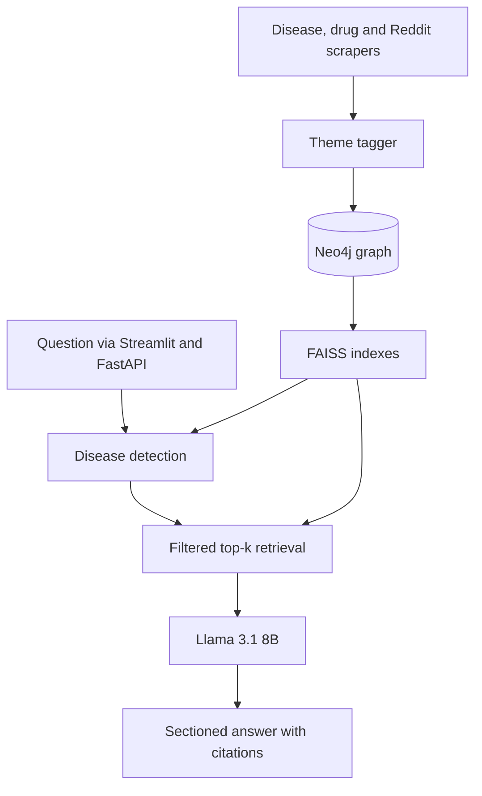
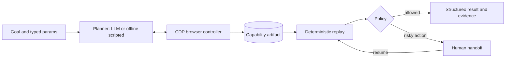
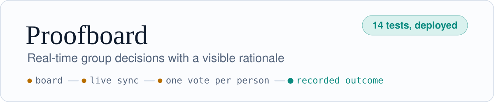

<picture>
  <source media="(prefers-color-scheme: dark)" srcset="assets/hero-dark.svg">
  
</picture>

I'm a software engineer working where applied AI meets full-stack product. As a full-time Software Development Intern at Next Play Games, I ship payments, team management, coach messaging and an AI personal trainer for the SportX1 platform across its mobile app, web dashboard and database. On my own projects I build AI systems whose output can be checked: a GraphRAG medical assistant with its own evaluation harness, and a computer-use agent that turns one LLM-guided run into a replayable, policy-checked artifact.

[](https://www.linkedin.com/in/dhyan-patel-94101b22a/)
<!-- TODO: uncomment once filled in
[](mailto:you@example.com)
[](https://yourdomain.dev)
[](https://yourdomain.dev/resume.pdf)
-->

```console
$ whoami
Dhyan Patel
applied AI and full-stack engineer

$ now
SWE intern @ Next Play Games
shipping SportX1: payments, teams,
messaging, AI personal trainer

$ stack --strongest
TypeScript, React, React Native,
Supabase, PostgreSQL, Python

$ open-to
software, full-stack and
applied AI engineering roles
```

## Experience

<a href="https://github.com/Next-Play-Games">
<picture>
  <source media="(prefers-color-scheme: dark)" srcset="assets/plate-nextplay-dark.svg">
  
</picture>
</a>

**Software Development Intern, Next Play Games** (full-time, June 2026 – present)

SportX1 is a sports coaching and team-management platform covering registration, payments, communication and AI-powered athlete training. I work across its React Native mobile app, React coaching dashboard and Supabase/PostgreSQL backend, with **88 merged pull requests across five company repositories** as of October 2026.

- **Registration and payments.** Web and mobile flows for Square payments, installment plans, recurring invoices, coupons, and audited cash and check payments, covered by 142 targeted tests.
- **Organizations and teams.** An organization, group and team hierarchy with cross-age-group reassignment, multi-team membership, parent notifications and admin permissions.
- **AI personal trainer.** Personalized training plans, habit tracking, progress views, privacy-conscious sharing and server-validated XP, with 74 focused tests.
- **Coach communication.** AI-assisted messaging, scheduled and recurring announcements with timezone handling, shared reply threads and reliable email delivery, covered by 161 tests.
- **Backend and deployment reliability.** Tighter database permissions, concurrency handling and migration ordering, plus deployment workflows that retry only on confirmed HTTP 409 conflicts.

**Stack.** TypeScript, React, React Native and Expo, Supabase, PostgreSQL, Square, GitHub Actions

## Featured projects

<a href="https://github.com/DhyanICT/Trusted_Medical_AI">
<picture>
  <source media="(prefers-color-scheme: dark)" srcset="assets/plate-trustmed-dark.svg">
  
</picture>
</a>

**Problem.** General-purpose chatbots answer health questions without showing where the answer came from, and blend vetted guidance with anecdote.

**What I built.** An assistant that retrieves from a Neo4j knowledge graph of disease and drug monographs plus semantically indexed patient discussions, then has Llama 3.1 8B write a sectioned answer that cites each source and labels it as trusted or community.

**The hard part.** Keeping anecdote from leaking into medical guidance. A FAISS disease index first detects which conditions the question is about, retrieval is filtered to those conditions, and every chunk carries its provenance into the prompt so the model can separate the two kinds of evidence. Community posts are tagged with recurring themes before indexing.

**Evidence.** An evaluation harness with hand-labelled ground truth, citation-presence checks and end-to-end completeness tests. Warm retrieval averages about 30 ms.

<picture>
  <source media="(prefers-color-scheme: dark)" srcset="assets/trustmed-retrieval-dark.svg">
  
</picture>

**Stack.** Python, FastAPI, Streamlit, Neo4j and Cypher, FAISS, sentence-transformers, Hugging Face Inference

[Code](https://github.com/DhyanICT/Trusted_Medical_AI) &nbsp;/&nbsp; [Evaluation guide](https://github.com/DhyanICT/Trusted_Medical_AI/blob/main/EVALUATION_GUIDE.md)

<details>
<summary><b>Architecture</b></summary>



</details>

<br>

<a href="https://github.com/DhyanICT/Computer-Use-Automation">
<picture>
  <source media="(prefers-color-scheme: dark)" srcset="assets/plate-cua-dark.svg">
  
</picture>
</a>

**Problem.** Legacy back-office software rarely has an API, and letting an LLM decide every click is slow, costly and hard to audit.

**What I built.** A Python system that runs one LLM-guided discovery pass against a UI, saves the successful run as a typed capability artifact (`cua.capability.v1`), and replays it deterministically with new parameters and no model in the loop.

**The hard part.** Making replay robust and safe. Steps target elements semantically (visible text, row label, nearby text) and keep CSS paths only as hints. Business outcomes such as `member_not_found` are reported separately from failures. An origin and action allowlist, log redaction, and a human-handoff seam pause before risky actions and resume in the same browser session.

**Evidence.** The browser controller speaks the Chrome DevTools Protocol directly, with no third-party packages. Every run writes JSONL logs, screenshots and DOM snapshots, and unit tests cover policy, redaction, parameter templating and the artifact schema.

**Stack.** Python, Chrome DevTools Protocol, OpenAI-compatible LLM API, unittest

[Code](https://github.com/DhyanICT/Computer-Use-Automation) &nbsp;/&nbsp; [Design report](https://github.com/DhyanICT/Computer-Use-Automation/blob/main/REPORT.md)

<details>
<summary><b>Architecture</b></summary>



</details>

<br>

<a href="https://github.com/DhyanICT/deepspace_proofboard">
<picture>
  <source media="(prefers-color-scheme: dark)" srcset="assets/plate-proofboard-dark.svg">
  
</picture>
</a>

**Problem.** Group decisions get made in chat threads, and the reasoning behind them disappears.

**What it does.** A shared board where a group frames a question, adds options, attaches reasons for and against with source links, votes once (and can change that vote), and records the outcome. Everyone sees options, reasons, vote counts and who is viewing, live.

**The hard part.** Integrity under concurrent edits. One ballot per person per board is enforced server-side in a Durable Object, not in the UI, and the client waits for confirmed writes so it never shows a vote the server rejected. Presence runs in a separate ephemeral room so it can't touch durable data.

**Evidence.** 14 passing tests, including a two-browser collaboration spec covering live options, vote changes, presence and outcomes, plus a Playwright check against the deployed app.

**Stack.** TypeScript, React, Vite, Cloudflare Workers and Durable Objects (DeepSpace), Playwright, Vitest

[Code](https://github.com/DhyanICT/deepspace_proofboard) &nbsp;/&nbsp; [Live app](https://proofboard-dhyan.app.space)

## More shipped work

**[Rules Quiz API](https://github.com/DhyanICT/nextplay-rules-fullstack)**. A TypeScript and Express API with Zod-validated endpoints and attempt scoring, tested with Jest and Supertest, plus a React (Vite) client and a React Native screen.

**[Task Board](https://github.com/DhyanICT/Task_Board_NextPlay)**. A Next.js 14 and Supabase Kanban board where anonymous sessions and row-level security keep each guest's tasks private, with drag and drop, search and priority filters. [Live](https://taskboard-gamma-ten.vercel.app/)

**[SparkScope](https://github.com/DhyanICT/Spark_Homes_Developer)**. An offline-first PWA for estimating repair costs during property walkthroughs. ZIP and Excel export are implemented in plain JavaScript with no dependencies, so exports work without a connection.

**[CycleSync](https://github.com/DhyanICT/CycleSync)**. A native Android (Java) cycle tracker with an offline chatbot that answers in English and Gujarati.

**[NYC taxi trip graph](https://github.com/DhyanICT/DPS1)**. A pipeline that cleans a month of NYC taxi trips from Parquet with pandas and loads them into Neo4j as a location graph using Cypher, uniqueness constraints and startup retries.

## What the work shows

| Capability | Where to see it |
| --- | --- |
| Production ownership | 88 merged PRs on SportX1 across mobile, web and database, from payments to deployment workflows |
| LLM systems with measured quality | TrustMed retrieval and citation evals; CUA's split between LLM discovery and LLM-free replay |
| Safety and data integrity | SportX1 database permissions and concurrency handling; CUA allowlist, redaction and handoff; Proofboard server-enforced voting |
| Testing as part of the build | SportX1 test suites for payments (142), AI trainer (74) and messaging (161); Playwright two-user specs; Jest and Supertest |
| End-to-end ownership | Features shipped from schema to mobile UI; deployed side projects with live links and documented trade-offs |

## Capabilities

**Languages.** TypeScript, Python, JavaScript, SQL, Java, Cypher

**AI and retrieval.** RAG over knowledge graphs, embeddings (sentence-transformers), FAISS vector search, LLM agents and planners, retrieval evaluation (precision, recall, F1 at k)

**Backend.** Supabase (PostgreSQL, Auth, row-level security), FastAPI, Node.js, Express, REST API design, Zod validation, Square payments, Cloudflare Workers and Durable Objects

**Frontend and mobile.** React, React Native and Expo, Next.js, Vite, Tailwind CSS, Streamlit, Progressive Web Apps, Android (Java)

**Data.** PostgreSQL (schema design, migrations, permissions), Neo4j, pandas, Parquet, web scraping and ETL

**Testing and delivery.** Playwright, Jest, Supertest, Vitest, unittest, GitHub Actions deployment workflows, Chrome DevTools Protocol

## Activity

<picture>
  <source media="(prefers-color-scheme: dark)" srcset="assets/activity-dark.svg">
  
</picture>

<sub>Generated weekly by <a href="scripts/generate_activity.py">a small script</a> in this repository, with no third-party stats service.</sub>

---

Reach me on [LinkedIn](https://www.linkedin.com/in/dhyan-patel-94101b22a/). <!-- TODO: add email and portfolio here too -->
