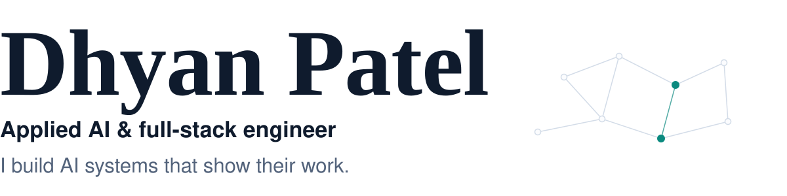
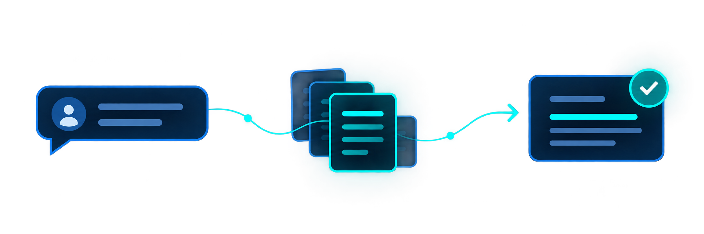
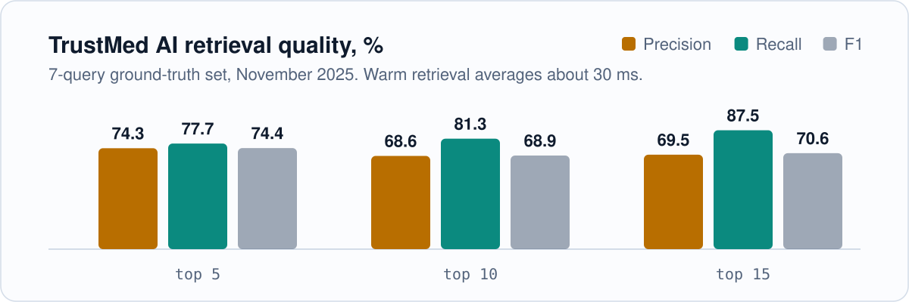
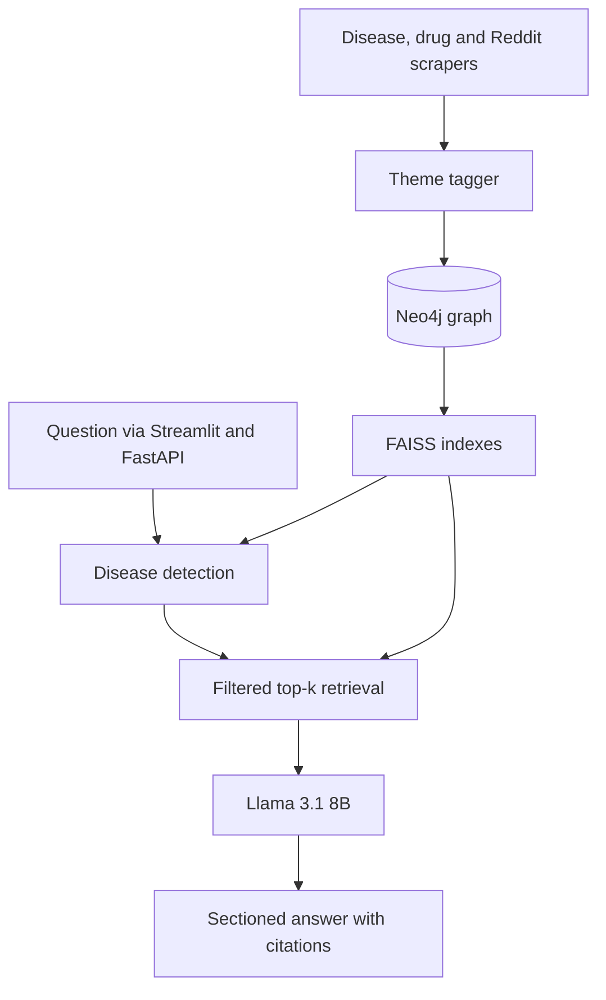
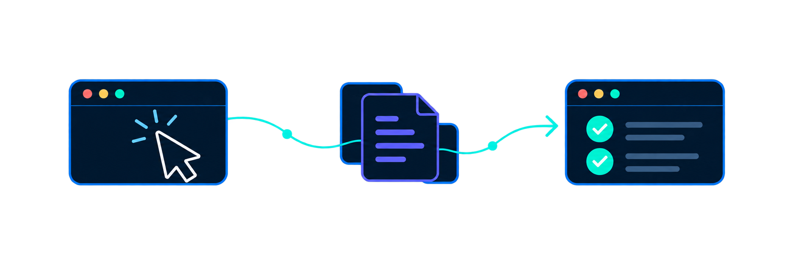
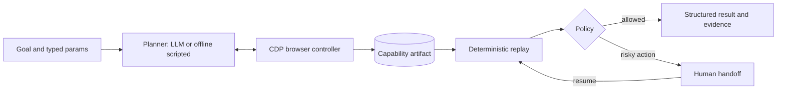
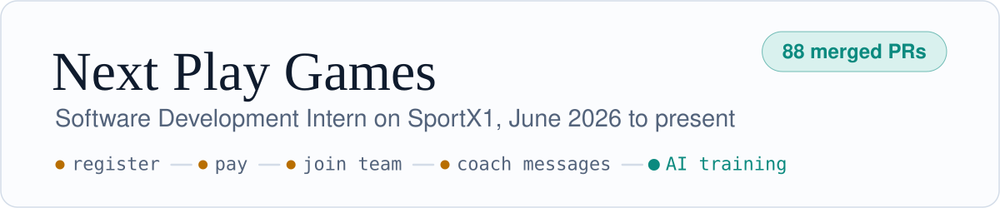
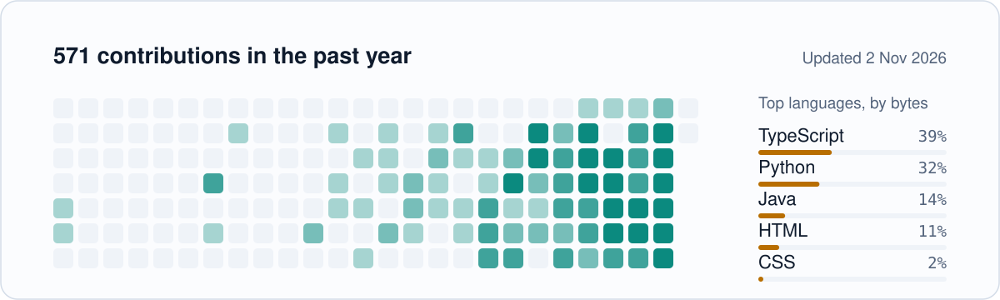

<picture>
  <source media="(max-width: 600px) and (prefers-color-scheme: dark)" srcset="assets/hero-mobile-dark.svg">
  <source media="(max-width: 600px)" srcset="assets/hero-mobile-light.svg">
  <source media="(prefers-color-scheme: dark)" srcset="assets/hero-dark.svg">
  
</picture>

<p align="center">
  <a href="#user-content-selected-work"></a>&nbsp;
  <a href="#user-content-experience"></a>&nbsp;
  <a href="https://www.linkedin.com/in/dhyan-patel-94101b22a/"></a>&nbsp;
  <a href="https://leetcode.com/u/3oZegdX01z/"></a>
</p>

<p align="center">Currently shipping SportX1 at <a href="https://github.com/Next-Play-Games">Next Play Games</a>.</p>

<br>

## About me

```console
$ whoami
Dhyan Patel
applied AI and full-stack engineer

$ now
SWE intern @ Next Play Games
shipping SportX1: payments, teams,
messaging, AI personal trainer

$ stack --strongest
TypeScript, React, React Native,
Supabase, PostgreSQL, Python

$ open-to
software, full-stack and
applied AI engineering roles
```

**How I work**

- **I measure.** Retrieval metrics, targeted test suites and evidence logs, not adjectives.
- **I design for failure.** Allowlists, human handoffs and rules enforced on the server.
- **I ship end to end.** Schema, API and mobile UI, then the deployment workflow.

<br>

## Selected work

### TrustMed AI

**Health questions, answered with cited evidence.**

<a href="https://github.com/DhyanICT/Trusted_Medical_AI">
  
</a>

A medical Q&A assistant that combines a Neo4j knowledge graph, FAISS vector search and Llama 3.1. Every answer cites its sources and keeps trusted medical information separate from patient experiences.

<picture>
  <source media="(prefers-color-scheme: dark)" srcset="assets/trustmed-retrieval-dark.svg">
  
</picture>

<details>
<summary><b>Architecture</b></summary>



</details>

Python &nbsp;·&nbsp; Neo4j &nbsp;·&nbsp; FAISS &nbsp;·&nbsp; Llama 3.1 &nbsp; | &nbsp; [Code](https://github.com/DhyanICT/Trusted_Medical_AI) &nbsp;/&nbsp; [Evaluation](https://github.com/DhyanICT/Trusted_Medical_AI/tree/main/evaluations)

<br>

### Computer-Use Automation

**Learn a browser task once. Replay it without an LLM.**

<a href="https://github.com/DhyanICT/Computer-Use-Automation">
  
</a>

A Python system that learns a browser task once, saves it as a reusable workflow and replays it with no LLM calls, with policy checks, data redaction and human handoff.

<details>
<summary><b>Architecture</b></summary>



</details>

Python &nbsp;·&nbsp; Chrome DevTools Protocol &nbsp; | &nbsp; [Code](https://github.com/DhyanICT/Computer-Use-Automation) &nbsp;/&nbsp; [Design report](https://github.com/DhyanICT/Computer-Use-Automation/blob/main/REPORT.md)

<br>

## Experience

<a href="https://github.com/Next-Play-Games">
<picture>
  <source media="(prefers-color-scheme: dark)" srcset="assets/plate-nextplay-dark.svg">
  
</picture>
</a>

**Software Development Intern, [Next Play Games](https://github.com/Next-Play-Games) (SportX1)** &nbsp;·&nbsp; June 2026 – present

SportX1 is a sports coaching and team-management platform. I work across its React Native app, React dashboard and Supabase/PostgreSQL backend.

- **Payments:** Square payments, installment plans, recurring invoices and coupons (142 tests)
- **Teams:** organization, group and team hierarchy with admin permissions
- **AI personal trainer:** training plans, habit tracking and server-validated XP (74 tests)
- **Coach messaging:** AI-assisted messages, scheduled announcements and reply threads (161 tests)

<br>

## More projects

- **[Proofboard](https://github.com/DhyanICT/deepspace_proofboard)**: real-time group decisions with live presence and one vote per person ([live](https://proofboard-dhyan.app.space))
- **[Task Board](https://github.com/DhyanICT/Task_Board_NextPlay)**: Next.js and Supabase Kanban board with row-level security ([live](https://taskboard-gamma-ten.vercel.app/))
- **[Rules Quiz API](https://github.com/DhyanICT/nextplay-rules-fullstack)**: TypeScript and Express API with React and React Native clients
- **[SparkScope](https://github.com/DhyanICT/Spark_Homes_Developer)**: offline-first PWA for estimating repair costs on site
- **[CycleSync](https://github.com/DhyanICT/CycleSync)**: Android cycle tracker with an offline English and Gujarati chatbot
- **[NYC taxi trip graph](https://github.com/DhyanICT/DPS1)**: Parquet-to-Neo4j pipeline built with pandas and Cypher

<br>

## Toolkit

**Languages:** TypeScript, Python, JavaScript, SQL, Java<br>
**Product:** React, React Native, Next.js, Node.js, FastAPI, Supabase, PostgreSQL<br>
**AI:** RAG, knowledge graphs (Neo4j), FAISS, LLM agents, retrieval evaluation<br>
**Testing:** Playwright, Jest, Vitest, GitHub Actions

<br>

## Recent activity

<picture>
  <source media="(prefers-color-scheme: dark)" srcset="assets/activity-dark.svg">
  
</picture>

<sub>Refreshed weekly by [a small script](scripts/generate_activity.py) in this repository.</sub>

<br>

<p align="center">
  <a href="#user-content-selected-work"></a>&nbsp;
  <a href="#user-content-experience"></a>&nbsp;
  <a href="https://www.linkedin.com/in/dhyan-patel-94101b22a/"></a>&nbsp;
  <a href="https://leetcode.com/u/3oZegdX01z/"></a>
</p>
